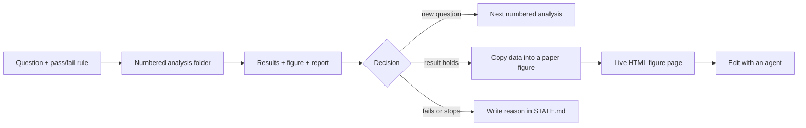

# empirical-march

empirical-march is an empty project template for doing science with coding agents (Claude Code, Codex). It is set up for projects that start with a question, grow through a series of numbered analyses, and end with a small set of preprint figures.

The main idea is that the files in the repository are the project's memory. Chat history does not last. A result only counts once its question, inputs, decision, and status are written down in the folder that owns it.

## Layout

The outer repository is the research workspace. The inner `code/project-dev` directory is the code.

```text
.
├── AGENTS.md                       rules for every agent
├── .agents/skills/                 reusable workflows
├── .claude/                        points Claude to the same rules and skills
├── assets/                         shared artwork and visual assets
├── code/
│   └── project-dev/
│       ├── AGENTS.md               rules for code changes
│       ├── src/project_name/       importable project code
│       ├── tests/                  tests
│       ├── notebooks/              demos (not the only copy of any result)
│       ├── registry/models/        model/run metadata
│       ├── cluster/                SLURM jobs and submission tools
│       └── analyses/
│           ├── AGENTS.md           rules for analyses
│           ├── _template/          copied for each new analysis
│           ├── take1/
│           │   └── 00_project_map/
│           │       ├── scripts/    code that produced the result
│           │       ├── results/    small output files (JSON, CSV)
│           │       ├── figures/    rendered figures
│           │       ├── notes/      plan, state, decisions
│           │       └── report.html readable summary of the analysis
│           └── preprint_figures/
│               ├── AGENTS.md       stricter rules for paper figures
│               └── take1/          one version of the paper's figures
│                   ├── manuscript.json
│                   ├── index.html  editable figure page + chat pane
│                   ├── server.py   local server for the page
│                   └── figure1/    plotting code, input data, old versions
├── labbook/                        project log and dashboard
├── literature/                     papers and reading notes
├── meeting-notes/                  dated meeting notes and decisions
├── outputs/                        exports for people outside the repo
└── stimuli/                        shared stimuli and where they came from
```

When starting a real project, rename `code/project-dev`, `src/project_name`, and the package metadata. Keep the folder roles the same.

## How a project grows

The analysis tree is a running record of what was asked and what was found. It is not a dumping ground for results.

1. **Question.** Make a numbered folder, for example `take1/07_attention_capture`. Before running anything expensive, write the question, the comparison, and what counts as pass or fail in `notes/plan.md`.
2. **Run.** Put local and cluster code in `scripts/` and small outputs in `results/`. Write job IDs, model hashes, seeds, datasets, and output paths in `notes/STATE.md`.
3. **Look.** Make a figure for each result that matters and rebuild `report.html`, which keeps the question, figures, captions, caveats, and decisions in one place.
4. **Branch.** If the result raises a new question, make the next numbered folder. Don't rewrite the old analysis to fit the new story.
5. **New take.** Start `take2`, `take3`, etc. when the main question or the standard of evidence changes enough that the old sequence would be misleading. Earlier takes stay as they are.
6. **Promote.** Only solid results move into `analyses/preprint_figures/takeN`. Each paper figure has its own plotting code, a small copy of its input data, notes on where that data came from and how it was checked, cluster scripts if needed, and a `z-old/` folder for old versions.
7. **Trim.** The paper figures make the smallest claim that holds together. Failed and dropped analyses stay in their original folders where anyone can find them.



## How agents are kept on track

There are two mechanisms.

**Nested instruction files.** `AGENTS.md` at the root applies everywhere. An `AGENTS.md` inside a folder adds rules for that folder. For example, analysis folders require a written pass/fail rule, cluster folders require a check for duplicate runs, and paper-figure folders require visual checks of every render. An agent reads every `AGENTS.md` from the root down to the file it is changing.

**Skills.** `.agents/skills/*/SKILL.md` describes workflows that come up in many places:

- `empirical-march`: create, run, document, stop, and hand off a numbered analysis;
- `scientific-figures`: make figures in the lab style, keep track of where their data came from, move them into the paper, and check every render at final size;
- `cannon-cluster`: connect to the cluster, choose storage and partitions, submit, monitor, and record jobs.

`.claude/skills` links to the same files, so Claude and Codex follow the same rules. The figure skill has two longer references: `house-style.md` (sizes, fonts, titles, colors, baselines) and `figure-lifecycle.md` (captions, moving figures into the paper, checking renders).

The folder structure also limits what an agent should touch. An agent working on one analysis should not refactor shared code, train new models, edit another analysis, or move a result into the paper unless asked.

## STATE.md

Every active analysis has one `notes/STATE.md`. A new agent (or person) should be able to pick up the work from this file alone, without the chat history. Keep it short. It should say:

- the question and the current pass/fail rule;
- what is done, running, blocked, stopped, or replaced;
- job IDs, hashes, seeds, and storage paths;
- the latest result and what was decided because of it;
- caveats, failed attempts, and duplicate-run checks;
- the next step, with the command or file to run.

Longer reasoning goes in `notes/decisions.md`. A running diary can go in `notes/log.md`. `STATE.md` is the current status, not a diary.

## Cluster access

The cluster setup is in [`docs/CLUSTER.md`](docs/CLUSTER.md) and `code/project-dev/cluster/`.

FASRC asks for a password and a two-factor code on every SSH login, which makes it hard for an agent to run anything on the cluster. We use [caxon/totp](https://github.com/caxon/totp) to fix this. You set it up once. After that, `start-ssh` opens a shared connection to the `cannon` login node, and every later `ssh`, `scp`, and `rsync` call reuses it without asking for a password or code. This lets an agent run jobs, debug on the cluster, and copy files back and forth for you. Setup steps are in [`docs/CLUSTER.md`](docs/CLUSTER.md#persistent-ssh-connection-totp).

Never put passwords, TOTP secrets, private keys, or other credentials in this repository.

The cluster files keep code on `/n/holylabs`, logs and temporary files on `/n/netscratch`, and long-term lab data on `/n/lab_storage`. `submit_fast.sh` checks both the `kempner_konkle_lab` and `konkle_lab` GPU partitions and submits to whichever starts soonest. Requeue partitions are only for jobs that save checkpoints and can resume.

## Live figure page

`code/project-dev/analyses/preprint_figures/take1` has a local web page for viewing and editing the paper figures. It only uses the Python standard library.

```bash
cd code/project-dev/analyses/preprint_figures/take1
python3 server.py 8767
# open http://127.0.0.1:8767
```

The page shows the figures and captions in `manuscript.json`, and you can edit headings, captions, and notes in place. Messages typed in the chat pane are added to `inbox.jsonl`. An agent running in your terminal watches that file, edits the plotting code or `manuscript.json`, re-renders the figure, and replies with `./reply.sh "..."` (`say.sh` does the same thing). The page then refreshes. `working.sh` turns on the "working" indicator.

The page does not call a model API. It just passes files back and forth with the agent you already have open, so no API keys are needed. The inbox, outbox, and status files are ignored by Git.

See [`docs/FIGURE_VIEWER.md`](docs/FIGURE_VIEWER.md) for details.

## Getting started

```bash
cd code/project-dev
python3 scripts/new_analysis.py --take take1 --name attention_capture
python3 scripts/validate_structure.py
python3 -m pytest
```

Then fill in the new analysis's `notes/plan.md` before running anything. When a take is ready to become a paper, use the preprint folder to pick the figures that matter rather than copying everything.

## What goes in Git

Track code, small results, config files, manifests, captions, notes, and final figures. Keep raw data, model weights, large caches, credentials, and cluster logs out of Git. Any external file used for a result still needs a fixed path plus a checksum, run ID, or manifest entry recorded in the repository.

## Background

This template is based on the analysis setup of an ongoing lab project as of 2026-10-24: numbered `take1`/`take2` analyses, `scripts/results/figures/notes/report.html` in each analysis, `STATE.md` handoffs, separate `preprint_figures/takeN` folders, SLURM launchers for Cannon, and the HTML figure page with a chat pane. Credentials and project-specific science were left out.
