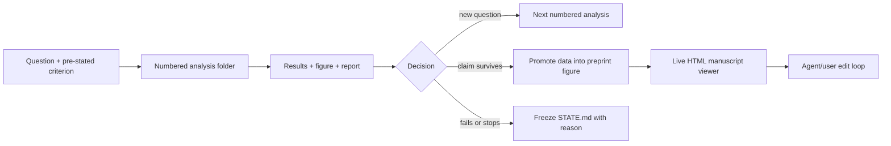

# empirical-march

This repository is a reusable, empty template for agent-driven scientific projects. It is designed for a scientific project that begins as a question, expands through many numbered empirical analyses, and eventually contracts into a small set of defensible preprint figures.

The central idea is simple: **the filesystem is the project memory**. Chat history is transient. A result is not part of the project until its question, provenance, decision, and current status are written into the folder that owns it.

## The two layers

The outer repository is the research workspace. The inner `code/project-dev` directory is the executable project.

```text
.
├── AGENTS.md                       global rules for every agent
├── .agents/skills/                 canonical reusable workflows
├── .claude/                        Claude-compatible pointers to the same rules
├── assets/                         durable source artwork and shared visual assets
├── code/
│   └── project-dev/
│       ├── AGENTS.md               software-level rules
│       ├── src/project_name/       importable project code
│       ├── tests/                  regression, parity, and smoke tests
│       ├── notebooks/              demonstrations, not sources of truth
│       ├── registry/models/        model/run metadata, never raw secrets
│       ├── cluster/                SLURM jobs, launch policy, environment template
│       └── analyses/
│           ├── AGENTS.md           empirical-analysis rules
│           ├── _template/          copied for each new numbered analysis
│           ├── take1/
│           │   └── 00_project_map/
│           │       ├── scripts/    code that produced the result
│           │       ├── results/    small machine-readable outputs
│           │       ├── figures/    rendered evidence
│           │       ├── notes/      plan, state, decisions, interpretation
│           │       └── report.html human-readable record of the analysis
│           └── preprint_figures/
│               ├── AGENTS.md       stricter publication-figure rules
│               └── take1/          one live manuscript attempt
│                   ├── manuscript.json
│                   ├── index.html  editable figure page + agent chat pane
│                   ├── server.py   local file-backed bridge
│                   └── figure1/    source, promoted data, history, cluster jobs
├── labbook/                        durable project log and dashboard
├── literature/                     papers, manifests, and reading notes
├── meeting-notes/                  dated decisions and presentation records
├── outputs/                        exports for people outside the code repo
└── stimuli/                        shared stimulus assets and provenance
```

Rename `code/project-dev`, `src/project_name`, and the package metadata when starting a real project. Keep the roles of the folders unchanged.

## How the project elaborates

The analysis tree is an append-only empirical argument, not a miscellaneous results folder.

1. **Question.** Start a numbered folder such as `take1/07_attention_capture`. Record the scientific question, why it matters now, the comparison, and the pass/fail criterion in `notes/plan.md` before expensive work.
2. **Execution.** Put runnable local and cluster code in `scripts/`. Put small, immutable outputs in `results/`. Record job IDs, model hashes, seeds, datasets, and exact output locations in `notes/STATE.md`.
3. **Interpretation.** Render every consequential result into `figures/`. Rebuild `report.html`, which keeps the question, figures, captions, caveats, decisions, and provenance together.
4. **Branching.** If the result motivates a new question, append another numbered folder. Do not silently rewrite the old analysis into the new story.
5. **New take.** Start `take2`, `take3`, and so on when the organizing question or evidentiary standard changes enough that the old sequence would become misleading. Earlier takes remain intact as the record of how the project learned.
6. **Promotion.** Only mature evidence moves into `analyses/preprint_figures/takeN`. A preprint figure owns a plotting source, a compact promoted-data layer, provenance/verification notes, cluster scripts if needed, and `z-old/` for visibly retired renders.
7. **Compression.** The live preprint page presents the smallest coherent claim. Failed and retired analyses remain discoverable in their original folders; they are not hidden, but they do not clutter the main figure sequence.



## How agents are constrained

There are two complementary control systems.

**Hierarchical instruction files.** `AGENTS.md` applies everywhere. A nested `AGENTS.md` adds rules for its subtree: analysis folders require pre-stated criteria and provenance; cluster folders require duplicate-run audits and safe submission; preprint folders require promoted data and visual verification. An agent must read every applicable instruction file from the repository root down to the file it will change.

**Reusable skills.** `.agents/skills/*/SKILL.md` describes workflows that recur across locations:

- `empirical-march`: create, run, document, stop, and hand off a numbered analysis;
- `scientific-figures`: reproduce the house figure grammar, manage figure provenance and manuscript promotion, and verify every render at final size;
- `cannon-cluster`: authenticate safely, choose storage and partitions, submit, monitor, and record cluster work.

The `.claude/skills` entries point to the same canonical files so Codex and Claude do not develop competing rules. The scientific-figure skill routes to detailed house-style and figure-lifecycle references, including exact print geometry, type scale, title grammar, baseline handling, captions, preprint promotion, and live-viewer verification.

The folder hierarchy also limits authority. An agent working in one analysis may not refactor project code, launch a new model family, revise another analysis, or promote a result into the manuscript unless the request and the applicable instructions authorize it.

## The durable progress contract

Every active analysis has one `notes/STATE.md` that a fresh agent can use without recovering a chat transcript. Keep it short enough to scan and concrete enough to resume. It must say:

- the question and current success criterion;
- what is done, running, blocked, stopped, or superseded;
- exact job IDs, hashes, seeds, and storage paths;
- the latest result and the decision it caused;
- caveats, failed attempts, and duplicate-run checks;
- one next action, including the command or file that owns it.

Long reasoning belongs in `notes/decisions.md` or a topic-specific note. Chronological detail may live in `notes/log.md`. `STATE.md` is the current truth, not a diary.

## Cluster setup in this template

See [`docs/CLUSTER.md`](docs/CLUSTER.md) and `code/project-dev/cluster/`.

The lab's Harvard FASRC pattern uses the `cannon` SSH alias for `login.rc.fas.harvard.edu`, a TOTP helper at `~/totp/scripts/start-ssh`, and SSH connection sharing (`ControlMaster` + `ControlPersist`). Run `start-ssh` once; later `ssh`, `scp`, and `rsync` calls reuse the authenticated control socket. `stop-ssh` closes it. GPU-node aliases may use `ProxyJump cannon`.

No password, TOTP seed, generated code, private key, AWS credential, or signed URL belongs in this repository. Only the setup pattern and non-secret host aliases are documented.

The cluster template separates durable code (`/n/holylabs`), temporary/high-volume work and logs (`/n/netscratch`), and durable lab data (`/n/lab_storage`). Its fast-submit helper tests both `kempner_konkle_lab` and `konkle_lab` GPU partitions and prefers the earliest estimated start. Requeue partitions are used only for jobs that checkpoint and resume correctly.

## Live figure page and agent chat

`code/project-dev/analyses/preprint_figures/take1` contains a working, standard-library-only live manuscript page.

```bash
cd code/project-dev/analyses/preprint_figures/take1
python3 server.py 8767
# open http://127.0.0.1:8767
```

The page renders `manuscript.json`, lets you edit headings/captions/notes in place, and writes saved changes atomically. The chat pane appends requests to `inbox.jsonl`. An active coding agent watches that file, edits plotting sources or `manuscript.json`, rebuilds the figure, then calls `./reply.sh "..."` (`say.sh` is a compatibility alias); the page notices the changed manuscript and image and refreshes. `working.sh` updates the pulsing progress indicator.

This is deliberately a local file bridge, not an embedded model API. It keeps the figure source, the editorial conversation, and the current manuscript state in one inspectable folder while leaving authentication and agent execution to the surrounding Codex/Claude session. Runtime inbox/outbox/status files are ignored by Git.

See [`docs/FIGURE_VIEWER.md`](docs/FIGURE_VIEWER.md) for the exact loop and safety boundary.

## Start a project

```bash
cd code/project-dev
python3 scripts/new_analysis.py --take take1 --name attention_capture
python3 scripts/validate_structure.py
python3 -m pytest
```

Then fill the new analysis plan before launching work. When a take becomes a coherent paper argument, use the preprint layer to curate rather than copy the entire empirical history.

## What belongs in Git

Track code, small results, configuration, manifests, captions, status notes, verification records, and final figures. Keep raw datasets, model weights, large caches, credentials, and ephemeral cluster logs outside Git. Every external artifact used in a claim still needs a stable path plus a checksum, run ID, or manifest entry recorded inside the repository.

## Provenance of this template

Built from the analysis conventions of an active research workspace as they existed on 2026-10-24: numbered `take1`/`take2` analyses, per-analysis `scripts/results/figures/notes/report.html`, `STATE.md` handoffs, separate `preprint_figures/takeN` promotion, Cannon SLURM launchers, and the file-backed HTML manuscript/chat viewer. Secrets and project-specific scientific content were intentionally excluded.
